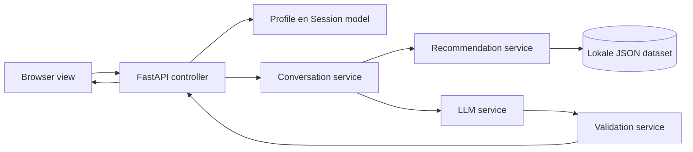
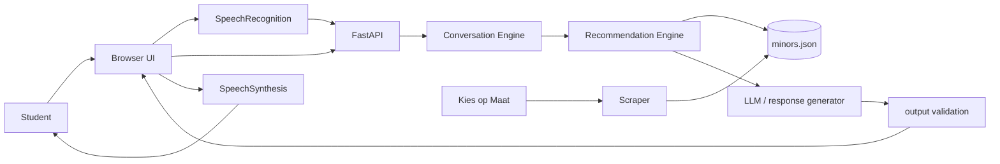

# Architectuur

## MVC met services

Minorly gebruikt een kleine MVC-indeling. `app/models.py` bevat het profiel, de sessie en de API-verzoekmodellen. `app/controllers/routes.py` behandelt HTTP en roept services aan. De view is `app/static/` met HTML, CSS en JavaScript. `app/main.py` verbindt die onderdelen; er staat geen gesprekslogica in de routes.

| Onderdeel | Bestanden | Verantwoordelijkheid |
| --- | --- | --- |
| Model | `app/models.py` | Profiel, tijdelijke sessie en requestvormen |
| View | `app/static/` | Chat, kaarten, microfoon en voorlezen |
| Controller | `app/controllers/routes.py` | Routes, invoer doorgeven en antwoorden terugsturen |
| Services | `app/services/` | Gesprek, ranking, optionele LLM en outputvalidatie |
| Samenstelling | `app/main.py` | Dataset laden en onderdelen aan elkaar koppelen |

De volledige gespreksflow staat in [flowchart.md](flowchart.md).

## Datastroom

De sessie leeft alleen in `ConversationEngine.sessions` in het serverproces. De browser gebruikt een willekeurige sessie-ID, zonder cookie. Herstarten van de server wist alle sessies. De gebruiker kan zelf `/api/reset` gebruiken. De dataset wordt bij het starten geladen. Na een scrape moet de server daarom opnieuw starten.

De ranking is uitlegbaar: woorden uit interesses wegen het zwaarst, gevolgd door ontwikkeldoel, opleiding en praktische voorkeuren. Ontweken termen worden uitgesloten. De LLM krijgt alleen de topkandidaten en mag uitsluitend bestaande ID's teruggeven. Ongeldige IDs, providerfouten en ontbrekende sleutels leiden tot de deterministische selectie. Namen en redenen worden nooit uit vrije LLM-tekst getoond.
