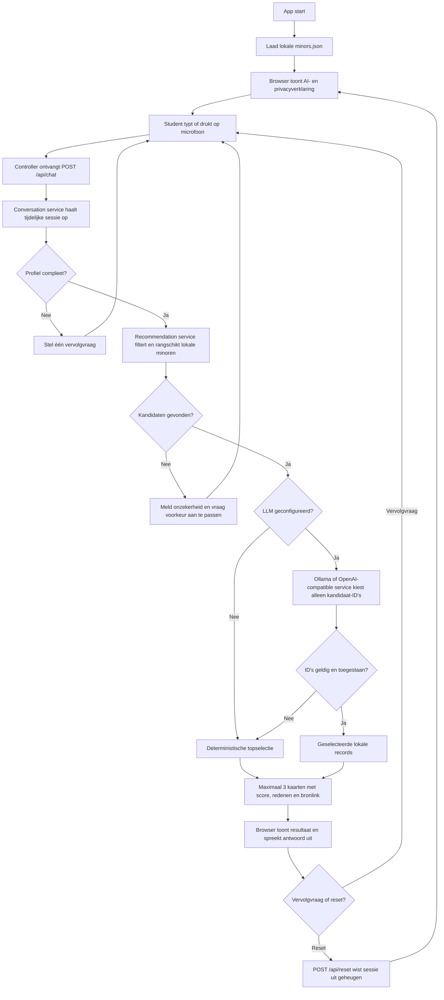

# MinorMatch workflow

Dit diagram toont de runtime-flow. De browser is de view, de FastAPI-routes zijn de controller, het profiel en de minorrecords zijn de modellen, en de services voeren gesprek, ranking en validatie uit.

## AI-modus

- Met `OLLAMA_BASE_URL` gebruikt de app Ollama om alleen bestaande kandidaat-ID's te selecteren.
- Zonder Ollama kan een OpenAI-compatible endpoint worden gebruikt wanneer `OPENAI_BASE_URL` en `OPENAI_API_KEY` zijn ingesteld.
- Zonder provider of bij een fout gebruikt de app deterministische regels. Dat is een veilige fallback, geen generatieve AI.
- Namen, details en matchredenen komen altijd uit lokale records en ranking. De LLM mag geen nieuwe minor aanmaken.
